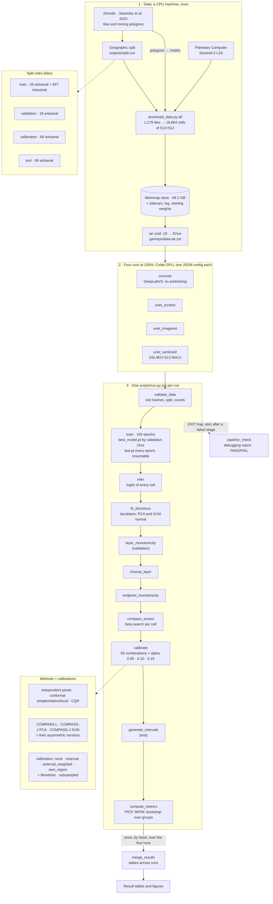

# 📐 Design

Read to understand what the experiment can conclude, and why its runs and rows are shaped as they
are. The facts these sections rely on are in [runs.md](runs.md).

## 👀 The experiment at a glance

The data are downloaded once, on your own machine, and reach the Colab GPU as one archive in Drive.
Each of the four runs is one `scripts/run.py` job:
`validate_data`, then the stages of `STAGE_ORDER` in `garimpo_uncertainty/stages.py`, and
`pipeline_check` last, also after a failed or interrupted stage. The model trains on `train`;
`validation` picks
`best_model.pt` and the layer. Intervals are evaluated on `test`, in 50 km clusters no other role
shares (`validate_data`'s `group_leakage`), and calibrated on the `calibration` role (`external`),
on it reweighted toward `test` by a density ratio (`external_weighted`), or on the other `test`
groups, leaving out the evaluated one (`own_region`); CQR's regressor is fitted on `train` cells.
`merge_results.py` then runs once, by hand, over the four runs. Tile counts come from
`outputs/split.csv`; methods and calibrations from `src/garimpo_uncertainty/intervals.py`.

## 🆚 What the model comparison varies

The experiment is one architecture with three starting weights, plus the ConvNet the proposal asks
for. The ConvNet is smp's DeepLabV3 with a ResNet-18 encoder, whose decoder reads only the deepest
feature, so it has no skip connections.

- The three U-Net runs vary where the model starts.
- The ConvNet against `unet_scratch`, both from random weights on the same ResNet-18 layers, varies
  the decoder (skip connections or none) together with the encoder's output stride: DeepLabV3
  dilates `layer3` and `layer4` to stride 8, where the U-Net's encoder downsamples to 32.

Each run is one training, so differences between variants have no replication behind them and the
comparison is descriptive only. Nor can a rerun reproduce a run: GPU kernels are not deterministic,
DeepLabV3's bilinear upsampling among them, so one seed gives slightly different weights on each
run. Only CPU runs on one kind of core repeat exactly, which the resume and worker tests rely on.

ResNet-18 is the smallest ResNet with both ImageNet and SSL4EO-S12 MoCo weights: a U-Net of 14.3 M
parameters, against 32.5 M with ResNet-50. Fixing one encoder for every model lets `LAYERS` carry
over between the U-Nets and keeps any run from mixing encoders.

## 🚧 Limits of the starting weights

- `sentinel2_moco` was trained on 13 top-of-atmosphere (L1C) bands, and these cells are L2A surface
  reflectance. The filters meet a different radiometry than the one they learned.
- Its original transform also resizes to 256 and crops to 224. Cells here stay at 512 pixels.
- Only the `conv1` columns of B2, B3, B4, B8, B11 and B12 are kept, without rescaling. The factor
  13/6 would assume every band contributes alike, and `bn1` follows `conv1`, so training
  re-estimates the activation scale.
- `imagenet` starts `conv1` from RGB filters that smp cycles over the 6 bands, so its first layer
  has no relation to these bands' wavelengths.

## 📊 Quantile rule and its sensitivity analysis

The main rows take the group quantile by CDF pooling (Dunn et al. 2022, §3.2), which weighs every
group equally but is valid only as k grows and for a continuous response. Dunn et al.'s
unsupervised simulation undercovers at k ≤ 35; their residual simulation, closer to this one, stays
near 1 - α (§4.4).

Here calibration has 25 groups and own region 23, and the areas are far from continuous: 372 of the
864 Amazon cells have no mining (`chips_amazon` minus `chips_amazon_nonempty` in
`outputs/frame.json`). Every `external` and `own_region` row is therefore repeated as
`external_subsampled` and `own_region_subsampled`, by repeated subsampling (§4.3, B = 100). That
rule draws one score per group per subsample, gives coverage of at least 1 - 2α for a new group at
any k (Theorem 10), and refuses at k ≤ 1/α - 1, where no interval is bounded. `external_weighted`
has no subsampled row, since subsampling has no definition with density-ratio weights.

Both rules see the same scores, so `coverage_comparisons.csv` and `width_comparisons.csv` already
pair them. How to read them was fixed before the data:

1. Robust: each method's Q2 verdict and the width order of the methods that pass are the same under
   both rules.
2. Pooling's own undercoverage: own-region coverage is below 0.90 by pooling and not by
   subsampling. The geographic effect is then read as external minus own region within one rule.
3. Geographic shift: external coverage falls under both rules and own region does not.

## 🌈 Inclusion

🏳️‍🌈 🏳️‍⚧️ LGBTQIA+ people are welcome in this project. What that means for issues, pull requests
and new text: [Inclusion](../README.md#-inclusion) in the README.
